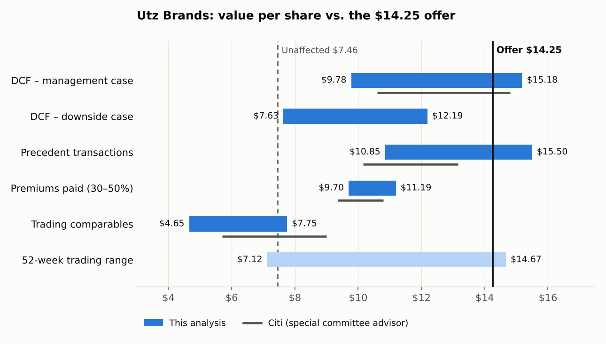

# Utz Brands Take-Private: Was Intersnack's $14.25 Offer Fair?

On July 20, 2026, Germany's Intersnack Group agreed to take **Utz Brands (NYSE: UTZ)** private for **$14.25 per share in cash**, about a $2.9 billion enterprise value. The founding Rice and Lissette family rolls its stake into the new company and will own 50% alongside Intersnack.

This project is an independent, fairness-opinion style valuation in Excel. It asks whether $14.25 was a fair price for the public shareholders who are being cashed out. It uses four methods and compares the results with the special committee advisor's (Citi's) own ranges from the deal filings.

**File:** [`Utz_Takeprivate_Valuation.xlsx`](Utz_Takeprivate_Valuation.xlsx). Live formulas, with a case selector on the DCF sheet.

## Verdict

**The offer looks fair, even generous, to public shareholders from a financial point of view.**

| Method | Value per share | Offer vs. midpoint | Citi range |
|---|---|---|---|
| DCF — management case | $9.78 – $15.18 (midpoint $12.04) | +18% | $10.60 – $14.80 |
| DCF — downside case | $7.63 – $12.19 (midpoint $9.54) | +49% | — |
| Precedent transactions | $10.85 – $15.50 | +8% | $10.15 – $13.15 |
| Premiums paid (30–50%) | $9.70 – $11.19 | +36% | $9.35 – $10.80 |
| Trading comparables | $4.65 – $7.75 | +130% | $5.70 – $9.00 |
| 52-week trading range | $7.12 – $14.67 | — | — |

- **$14.25 is above the midpoint of every method.** It sits near the top of the DCF range and inside the precedent transaction range.
- **The premium is about 91%** to the $7.46 unaffected price, roughly double the 30–50% typical for all-cash deals. The offer is only 3% below the 52-week high of $14.67.
- **Utz could not be worth $14.25 as a standalone public company.** Peers trade at about 7.5x trailing EBITDA, which implies $4.65–$7.75 per share. Only an acquirer paying for control, at 12.7x EBITDA, gets to $14.25.
- **The offer needs management's plan to fully work.** It pays for margins expanding from 15.3% to 18.1% by 2031. In the downside case, with growth 1 point lower and half the margin gains, the DCF midpoint drops to $9.54. Management itself said it saw more downside than upside risk to its projections.

**Process points worth noting:**
- The founding family rolls its equity and ends up owning 50%, so insiders sit on both sides of the deal. This is mitigated by requiring a majority vote of unaffiliated shareholders.
- There was no go-shop, and the termination fee is $50 million.
- Intersnack raised its bid five times, from $11.00 in March to $14.25, which shows negotiation by the special committee.

## Deal terms and implied multiples

| | Value |
|---|---|
| Offer price | $14.25 cash |
| Equity value (146.1mm fully diluted shares) | $2,082mm |
| Enterprise value (net debt $791mm at June 28, 2026) | **$2,873mm** |
| EV / LTM adjusted EBITDA ($226.3mm) | **12.7x** |
| EV / 2026 plan EBITDA ($232mm) | 12.4x |
| EV / 2027E EBITDA ($246mm) | 11.7x |
| Premium to unaffected price ($7.46) / 30-day VWAP / 90-day VWAP | 91.0% / 91.5% / 89.0% |

## How each range was built

- **DCF.** Uses management's projections from the special committee materials filed with the Schedule 13E-3. The model reproduces management's unlevered free cash flow ($105 → $173mm) to within $1mm.
  - WACC of 8.1%: 10-year Treasury 4.57% (announcement week), relevered beta 0.88, 5.5% equity risk premium, 7.8% pre-tax cost of debt, 35% debt-to-capital.
  - Terminal growth of 1.5–2.5%, mid-year discounting, valued as of June 28, 2026.
  - The terminal value is 76% of enterprise value, so the sensitivity grid matters.
- **Trading comparables.** Citi's seven mid-cap food peers: Post, Marzetti, Flowers, BellRing, B&G, Simply Good Foods and J&J Snack Foods. They trade at a median 7.5x LTM EBITDA, and I applied 6.5–8.5x. Large-cap snack companies (Campbell's, General Mills, Hershey, Mondelez) are shown for reference only.
- **Precedent transactions.** Five snack and food deals:

  | Deal | EV / EBITDA |
  |---|---|
  | Mars / Kellanova | 16.4x |
  | Smucker / Hostess | 17.2x |
  | Campbell / Snyder's-Lance | 19.9x |
  | Ferrero / WK Kellogg | 12.5x (calculated) |
  | Investindustrial / TreeHouse | 8.5x (calculated) |

  The large branded deals involved faster-growing, higher-margin businesses. I therefore anchored on the two most recent similar-sized deals and applied 10.5–13.5x.
- **Premiums paid.** A typical 30–50% all-cash premium on the unaffected price.

## Limitations

- Peer prices are from October 16, 2026, after the announcement, not the unaffected date. Food stocks fell further after July 2026.
- Peer EBITDA comes from a market data provider and may include some one-time items. Utz figures are company-adjusted.
- Management projections and Citi's ranges come from the special committee materials and a summary of the proxy, not the final definitive proxy.
- The tax receivable agreement settlement and Utz's tax loss carryforwards are not valued separately.
- This is a portfolio exercise prepared from public information, not investment advice.

## Sources

- [Utz Q2 2026 earnings release](https://www.sec.gov/Archives/edgar/data/0001739566/000162828026052888/pressrelease-2026q2earning.htm) and [Q4 2025 earnings release](https://www.sec.gov/Archives/edgar/data/1739566/000162828026007457/pressrelease-2025q4earning.htm)
- [Utz / Intersnack announcement](https://investors.utzsnacks.com/news/news-details/2026/Utz-Brands-Inc--and-Intersnack-Group-GmbH--Co--KG-Announce-Agreement-to-Take-Utz-Private-and-Partnership-with-Founding-Family/default.aspx)
- Citi special committee materials, Schedule 13E-3 exhibits: [March 31, 2026](https://www.sec.gov/Archives/edgar/data/1739566/000119312526362085/d75151dex9916cxx.htm) and [April 17, 2026](https://www.sec.gov/Archives/edgar/data/1739566/000119312526362085/d75151dex9916cxxi.htm)
- [Proxy summary — For Fairness Sake](https://forfairnesssake.substack.com/p/for-fairness-sake-utz-to-be-acquired)
- [10-year Treasury rate, weekly (YCharts)](https://ycharts.com/indicators/10_year_treasury_rate_weekly)
- Peer market data: [StockAnalysis.com](https://stockanalysis.com/stocks/) (October 16, 2026)
- Precedents:
  - [Mars / Kellanova](https://www.nasdaq.com/press-release/mars-acquire-kellanova-2024-08-14)
  - [Smucker / Hostess](https://www.preparedfoods.com/articles/128505-the-j-m-smucker-co-to-acquire-hostess-brands)
  - [Campbell / Snyder's-Lance](https://www.sec.gov/Archives/edgar/data/0000016732/000095015917000274/ex99-1.htm)
  - [Ferrero / WK Kellogg](https://www.nasdaq.com/press-release/ferrero-acquire-wk-kellogg-co-2025-07-10)
  - [TreeHouse / Investindustrial](https://www.treehousefoods.com/news-and-media/press-release-details/2025/TreeHouse-Foods-Inc--Reports-Third-Quarter-2025-Results/default.aspx)

*Tools: Excel (DCF with case selector and sensitivity grid, trading comps, precedent transactions, football field), Python for the chart.*
